# Architecture Guide

This guide shows how the multi-agent study guide evolves from a simple Python pipeline into a complete application architecture. Each diagram uses the actual project components and routing behavior.

- V1-V17 are implemented.
- V17 is verified for local browser and API use. Its optional Docker recipe has not been runtime-verified; public hosting is outside the implemented scope.
- Solid arrows show the normal execution path.
- Labeled branches show conditional routing, review decisions, or recovery behavior.

## Architecture evolution

| Stage | Versions | Main idea |
|---|---|---|
| Foundations | V1-V3 | Sequential generation and clearer notes |
| Coordination | V4-V6 | Parallel work, delegation, and routing |
| Control | V7-V8 | Human approval and automated refinement |
| Reliability | V9-V10 | Structured outputs, fallbacks, and persistent recovery |
| Context | V11-V13 | Long-term memory, retrieval, and tools |
| Adaptation | V14-V16 | Dynamic planning, evaluation, and human control |
| Delivery | V17 | Local application, asynchronous API, persisted reviews, and optional Docker recipe |

## V1: Plain Python sequential agents

**Status:** Implemented

V1 passes ordinary Python return values from one focused LLM call to the next. There is no graph runtime or shared state object.

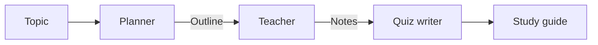

## V2: LangGraph sequential workflow

**Status:** Implemented

V2 preserves the V1 sequence but moves orchestration into a LangGraph state graph. Each node reads and updates shared `StudyState`.

## V3: Sequential simplification

**Status:** Implemented

V3 adds a simplifier between teaching and quiz generation so the quiz is based on the clearer notes.

## V4: Parallel specialist workers

**Status:** Implemented

Three specialists receive the same topic at the same time. LangGraph waits for all branches before the merger creates the final guide.

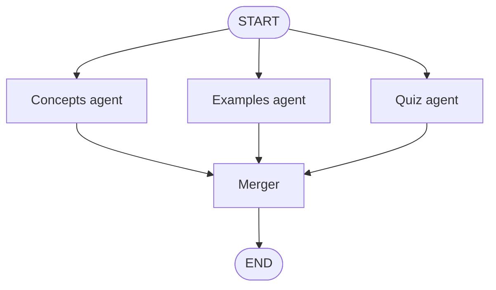

## V5: Orchestrator and delegated subagents

**Status:** Implemented

The orchestrator creates task assignments. `Send` dynamically launches a subagent for each assignment, and the synthesizer combines their results.

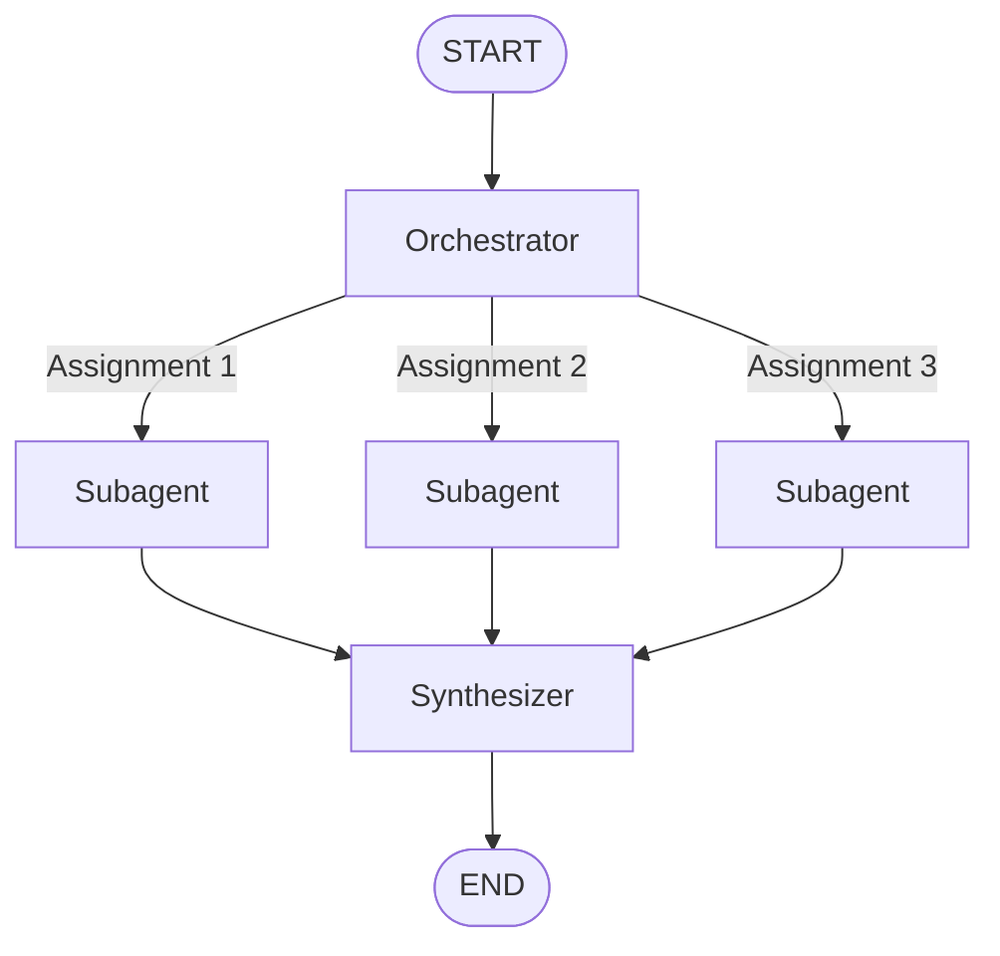

## V6: Supervisor routing

**Status:** Implemented

The router classifies the requested learning level. Only the selected teacher branch runs before the shared quiz writer.

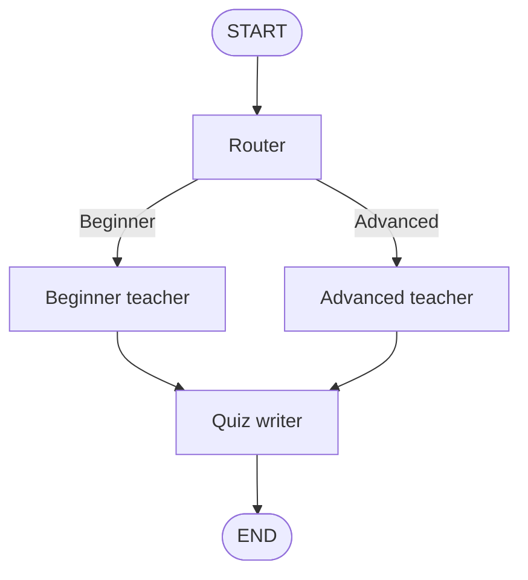

## V7: Human approval loop

**Status:** Implemented

The graph interrupts after an outline is prepared. Approval continues to teaching, while rejection stores feedback and loops through outline revision.

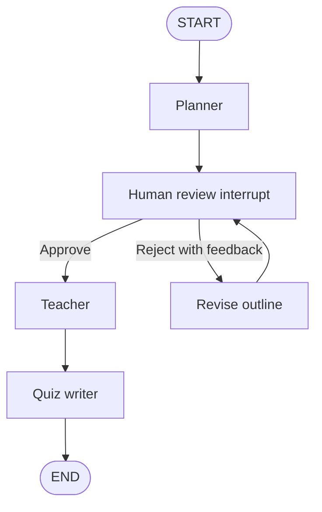

## V8: Automated review and refinement

**Status:** Implemented

The reviewer checks the generated quiz. A rejected quiz goes to the reviser and returns for another review. Approval or the revision limit ends the graph.

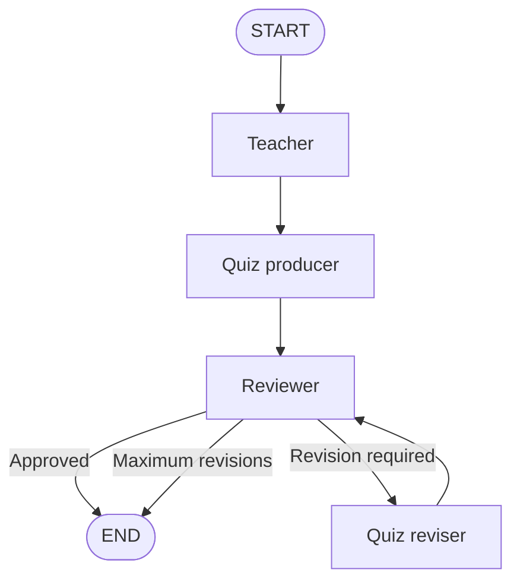

## V9: Structured multi-agent workflow

**Status:** Implemented

V9 combines validated routing, structured assignment planning, dynamic parallel workers, synthesis, quiz generation, structured review, retry controls, and safe termination.

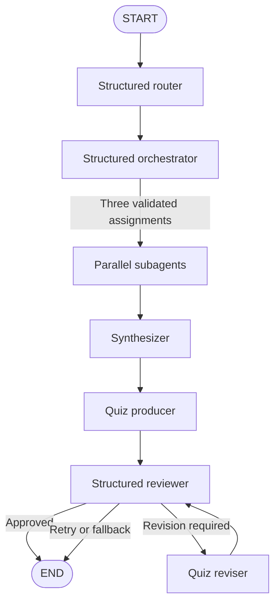

### V9 reliability controls

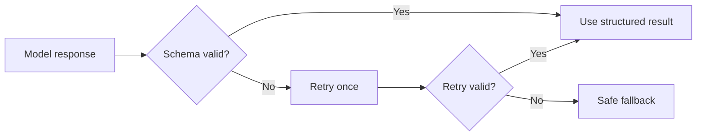

## V10: Persistent checkpointing and recovery

**Status:** Implemented

V10 compiles the V9 graph with `SqliteSaver`. A thread ID connects each session to durable graph state, allowing pause, resume, completed-session loading, and recovery without repeating completed nodes.

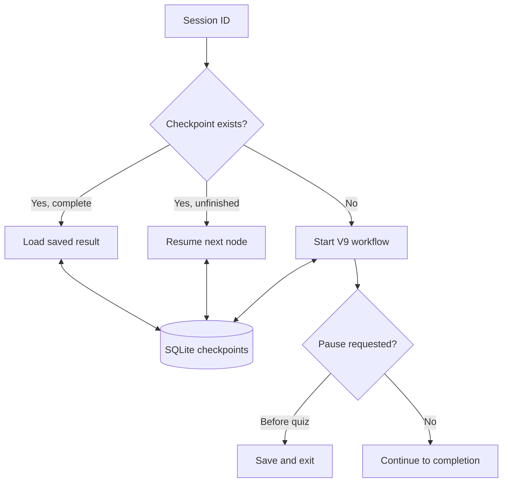

### V10 workflow with persistence

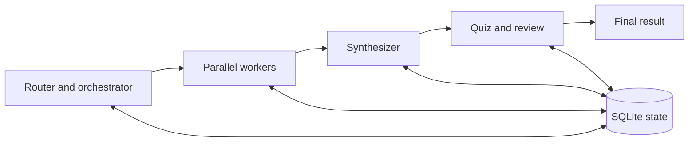

## V11: Cross-session learner memory

**Status:** Implemented

V11 reuses the tested V10 graph while keeping long-term learner memory separate from per-session checkpoints. It recalls a validated profile before graph execution, uses the preferred level for routing, and saves an outcome only after explicit approval.

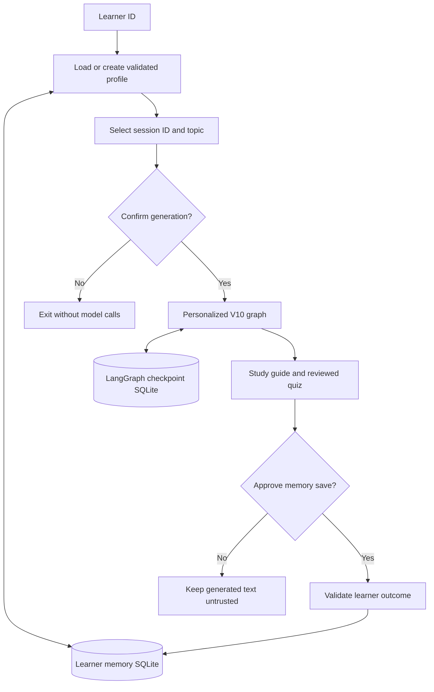

The learner-memory store contains learner level, preferences, completed topics, quiz performance, recurring mistakes, and recent progress. Generated study-guide text is not stored as trusted memory. The eight deterministic tests verify validation, persistence, deduplication, learner isolation, summaries, and safe outcome storage without calling Ollama.

## V12: Retrieval with trusted documents and citations

**Status:** Implemented

V12 reuses V11 learner memory and adds deterministic retrieval from approved local Markdown sources. Stable source IDs and section headings produce independently ranked chunks. The selected chunks receive session citation labels, and only that cited context is passed to grounded workers and the quiz producer.

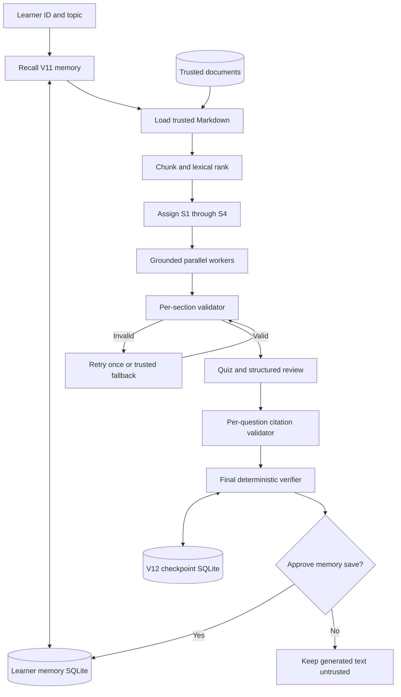

V12 validates each generated section and each quiz question independently. Every item must contain substantive text and at least one allowed citation. An invalid worker response receives one corrective retry. If the retry remains blank, insubstantial, or uncited, the workflow uses deterministic text derived from the retrieved trusted source. Missing or unknown citation IDs block final validation and prevent trusted-memory storage.

The 19 deterministic tests run without Ollama, network access, or a vector database. They verify loading, 14-section chunking, lexical ranking, deterministic results, citation mapping, malformed and duplicate source rejection, item-level validation, corrective retry behavior, trusted-source fallback, and blocking of invalid final output. A verified end-to-end run produced three substantive cited sections, three cited quiz questions, `approved` review status, `valid` citation status, and a 3,056-second local workflow time.

## V13: Tool-using study agents

**Status:** Implemented

V13 adds schema-controlled tool selection to the V12 trusted-context foundation. The model can request only a tool in the closed registry. Deterministic validation runs before and after execution, every observation receives a `[T#]` reference, and final answers may use only source citations and tool references that were actually returned.

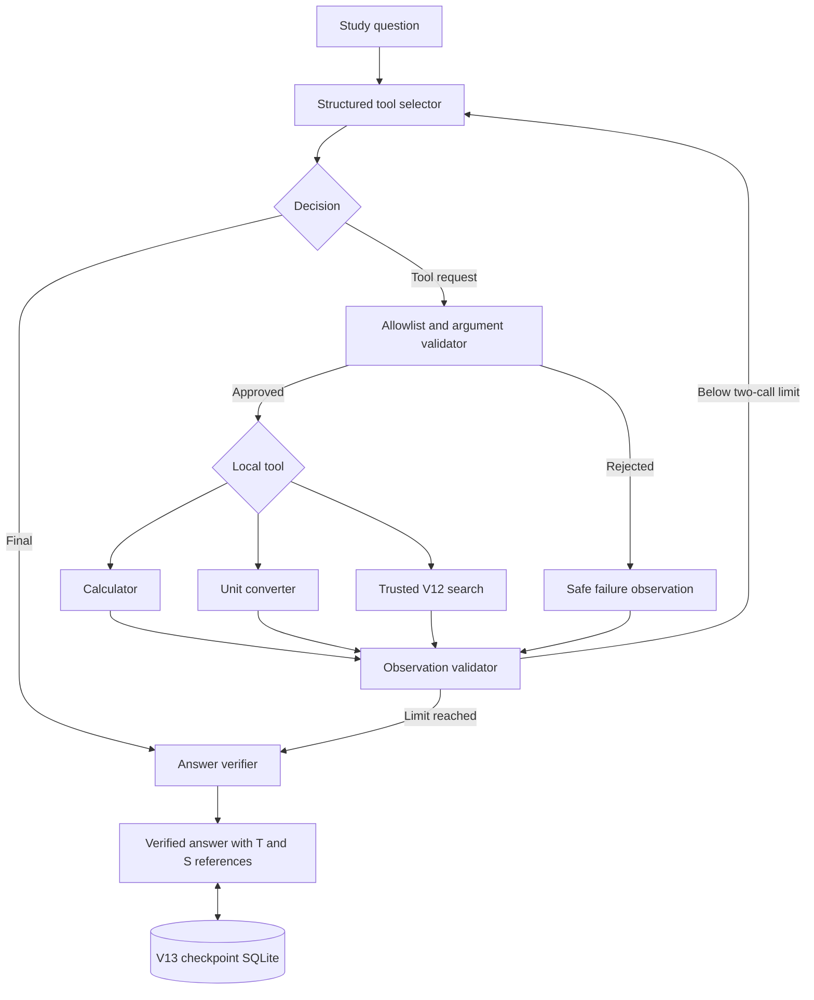

The calculator parses a bounded numeric abstract syntax tree and never calls Python `eval`. The unit converter uses a fixed table for approved length, mass, and time units. Trusted search reuses V12 deterministic retrieval and citation verification. No shell, arbitrary-code, or network tool is registered.

Model selection receives one structured-output retry before deterministic routing takes over. Unknown tools and invalid arguments produce structured safe failures instead of execution. The answer verifier rejects unknown `[T#]` references and any `[S#]` citation not returned by trusted search.

Thirty deterministic tests verify the registry, calculator, unit conversion, trusted search, schemas, routing, references, and failure handling without Ollama or network access. A verified end-to-end run selected the unit converter and returned `5.0 km = 5000 m [T1]`. A separate actual-corpus test returned validated V12 friction and energy evidence with `[S1]`, `[S2]`, and `[T1]`.

## V14: Dynamic planning and agent selection

**Status:** Implemented

V14 validates a plan of one to four tasks and selects researcher, calculator, or
converter specialists. Model planning receives one corrective retry, then uses a
deterministic fallback. The evaluator checks planned task completion and allows
one replan for unfinished work. Completed tasks stay frozen across replanning.

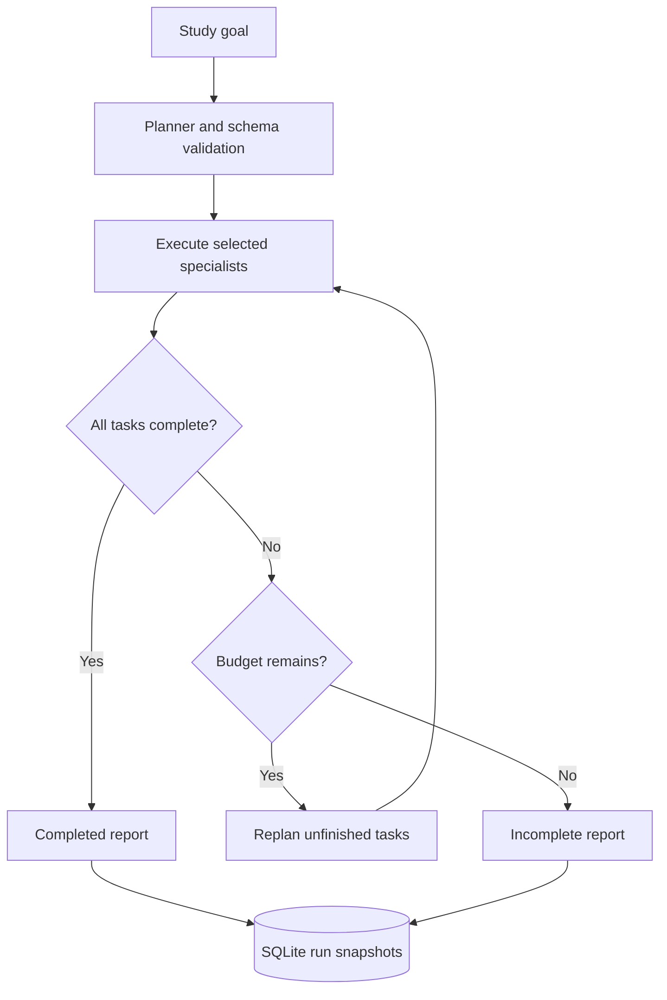

Research tasks reuse V12 lexical retrieval with globally consistent source labels
within the run. Calculator and converter tasks reuse V13 tool validation.
Dependencies control execution order and block tasks with failed prerequisites;
they do not substitute prior results into later tool arguments. Eight total tool
executions and one replanning round bound the workflow.

Offline execution uses a Python loop; normal execution uses LangGraph nodes for
planning, specialist execution, evaluation, and replanning. Tests verify matching
results and bounded termination. Run snapshots bind the goal and corpus digest to
a session ID and can reload completed or incomplete reports. They do not resume
interrupted nodes. SQLite connections are explicitly closed on every path.

Verified evidence includes 31 passing Windows tests, a three-specialist offline
run, a live Ollama plan accepted on attempt 1 with three completed tasks, and a
division-by-zero run that stopped as incomplete after two executions and one
replan. The evaluator establishes execution completion, not semantic coverage of
arbitrary goals or learner mastery. Details are in [the V14 guide](V14_GUIDE.md).

## V15: Evaluation and observability

**Status:** Implemented

V15 wraps V14's planning, specialist, evaluator, and replanning nodes to record
ordered spans and outcomes. A separate model wrapper measures actual structured
model invocations, including call failures. The observer preserves V14 execution
state while attaching metrics, citation-integrity checks, and saved reports.

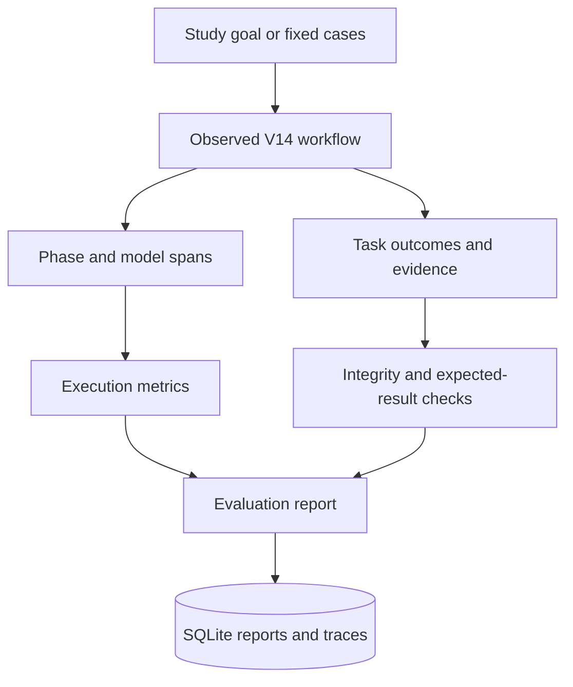

The fixed offline suite has five cases: arithmetic, conversion, compound tool use,
division by zero, and missing evidence. Expected incomplete outcomes pass their
evaluation cases. Saved reports reload without tools or models; connections close
explicitly on both successful and error paths. Reports are final artifacts, not
resumable node checkpoints.

Verified runtime evidence includes a five-of-five actual-corpus benchmark and a
live run with three completed tasks, one model attempt, one accepted plan, no
fallback, and 234.684 seconds elapsed. Development tests cover 27 paths, including
actual graph parity, model retry accounting, evidence mismatch rejection, and
SQLite closure.

Citation checks establish ID integrity and retained-source consistency, not
semantic support or goal coverage. The live researcher selected one energy-forms
passage; the report does not claim that this fully explains conservation. Timings
are per phase and model call; nested timings overlap, and per-tool latency and
token usage are not measured. See [the V15 guide](V15_GUIDE.md).

## V16: Multi-stage human approval

**Status:** Implemented

V16 expands V7 into durable plan, content, and final approval gates. Each review
uses a native LangGraph interrupt with SQLite persistence. V14 handles validated
planning and local tool execution; V15 provides trace and evidence-integrity checks.

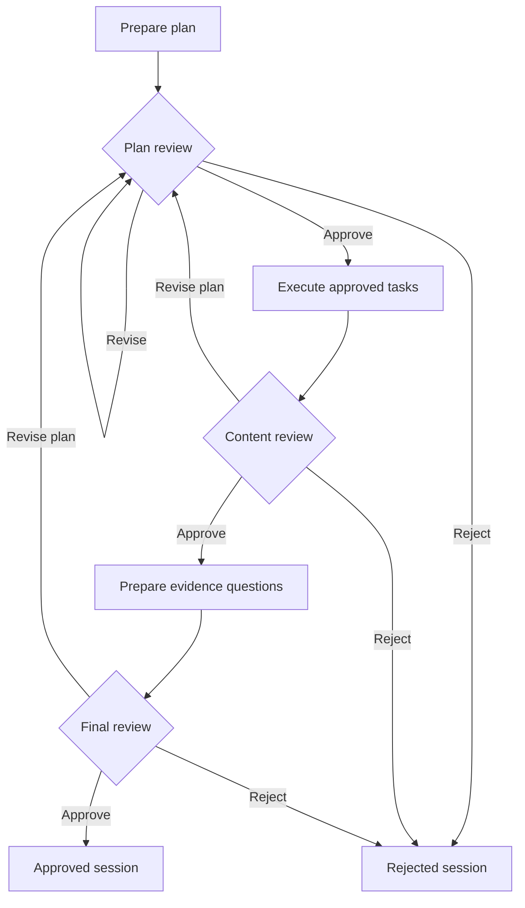

All review gates support pause and resume under the same session ID. They do not
perform model or tool work before the interrupt. Revision validates a replacement
plan, clears approvals and assessment, and invalidates changed tasks and dependent
results while retaining unchanged completed tasks. Three revisions and eight tool
executions bound a session. Incomplete content and failed evidence checks block
approval. Final questions refer to the current approved task rather than stale
request wording; the original request is retained separately as history.

Verified evidence includes 32 passing Windows tests, an offline pause/exit/resume
with no repeated tool execution, successful human correction of a failed arithmetic
task, and a model-mode conversion run with all three approvals. The test suite
covers real SQLite reopening, CLI resume, stale decisions, rejection, dependency
invalidation, and the `v16.2` task-label correction.

Review checkpoints are bound to the source corpus, implementation version, and
offline/model mode. Completed `v16.1` sessions remain stored but cannot resume with
the changed `v16.2` assessment format. Automatic replay is disabled for sessions
that stopped outside a review gate; exactly-once execution after an arbitrary
process crash is not guaranteed. The local workflow is single-process-per-session
and does not authenticate reviewer identity. Assessment questions are unscored,
and approval does not establish mastery or semantic entailment. See
[the V16 guide](V16_GUIDE.md).

## V17: Application and deployment

**Status:** Implemented and locally verified; Docker execution unverified

V17 serves Review Studio and a same-origin JSON API through a local Python HTTP
server. A single background worker serializes creation and review operations.
POST returns 202 after queuing; GET polls a cached session view without invoking
the model, tools, or graph. A slow model operation can delay other queued jobs.

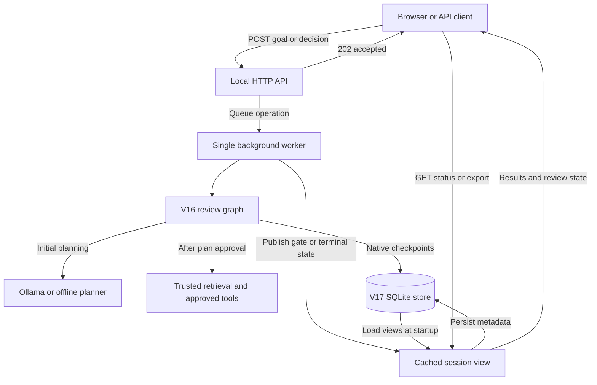

The graph reuses V14 task validation and execution, V12 trusted retrieval, V13
bounded tools, and V15 metrics and trace wrappers. It pauses at V16's plan,
content, and final gates. Revision invalidates affected results and clears
approvals; rejecting ends the session. Reading or reopening a session does not
advance a gate. A review ID binds each decision to its current state, while
request IDs deduplicate accepted review submissions. Creation is not idempotent.

`v17_data/sessions.sqlite` contains native graph checkpoints and web-session
metadata. It is separate from V16's CLI database and V11's learner memory.
V17 does not update learner memory, turn generated content into trusted facts,
or import JSON exports as runnable sessions. Ignore the entire data directory.
Recovery inspection reads a saved gate or terminal state without executing nodes;
automatic replay after interruption outside a gate is refused. Crash-time
exactly-once tool execution is not guaranteed.

The service uses localhost by default, Host/Origin checks, a process-local write
token, bounded JSON input, and fixed static-asset routes. The interface renders
model and user text through textContent. These controls do not provide public
authentication, multi-user isolation, or tamper-proof audit storage. One process
owns each data directory. An optional non-root Docker recipe uses a named volume
and publishes the host port only on loopback; the image has not been built or
runtime-tested in the verified evidence.

Verified evidence includes 25 API integration tests in the authoring environment,
90 existing V14-V16 tests there, Windows browser approval of two offline tasks,
and a human revision from `1 / 0` to `1 / 2` that completed with `0.5 [T2]`.
The exported live Ollama session accepted its second model attempt after a first
`OutputParserException`, recorded zero deterministic planning rounds, executed
the converter once, returned `5 km = 5000 m [T1]`, and saved all three approvals.
Planning took 526.872 seconds; the specialist phase took about 6.273 milliseconds.
Human review time is excluded from these phase timings. See
[the V17 guide](V17_GUIDE.md) for API and deployment details.

## Version relationships

Later versions build on earlier capabilities, but every file remains runnable as a separate learning example.

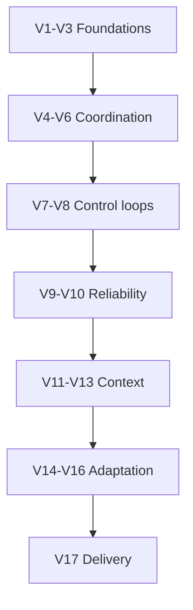

The architecture is intentionally incremental. V17 adds the application layer as a separate version while preserving the earlier runnable examples. Local application verification does not establish production readiness or public deployment.
