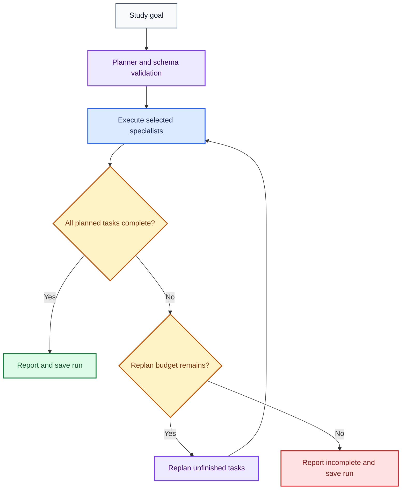

# V14: Dynamic Planning and Agent Selection

Status: implemented and validated on Windows with the actual trusted corpus.
V14 is included in the published v17.0.0 baseline.

V14 adds a validated plan, selective specialist execution, progress evaluation,
and one bounded replanning round. Earlier version files are reused as imports.
No package or model change is required beyond the V13 requirements.

## Files

- `study_guide_v14_dynamic_planning.py`
- `test_v14_dynamic_planning.py`
- This guide, installed as `docs/V14_GUIDE.md`.

## Architecture

Diagram colors follow the [architecture color key](ARCHITECTURE.md#diagram-color-key).



## Agent selection

| Agent | Execution | Evidence |
|---|---|---|
| Researcher | V12 lexical retrieval over approved local Markdown | Session-global source citations plus tool references |
| Calculator | V13 bounded numeric arithmetic tool | Validated tool observation |
| Converter | V13 approved unit conversion tool | Validated tool observation |

Only the planner uses the model. Specialist execution and the final report are
deterministic. The report retains the source text or tool result rather than
asking the model to rewrite evidence. Search citations share one map across the
run, so separate searches cannot reuse `[S1]` for different passages. The source
list includes the file, heading, and stable chunk ID.

Dependencies enforce execution order. They do not substitute one task's numeric
result into another task's arguments. Use literal arithmetic and conversions.

## Budgets and recovery

- One to four tasks per plan.
- At most two model attempts per planning round, followed by deterministic fallback.
- At most one replanning round and eight total tool executions.
- Completed tasks are retained, frozen, and not executed again during replanning.
- A replan must retain all original task IDs and instructions.
- Failed prerequisites block dependent tasks.
- Invalid tool arguments or missing evidence produce incomplete results.
- For deterministic compound requests, separate clauses with semicolons.

The deterministic evaluator checks that every planned task produced a valid
result. It does not establish that the model decomposed an arbitrary natural
language goal correctly, that retrieved passages answer every nuance of a goal,
or that the learner mastered the subject. Review plans and evidence accordingly.
For semicolon-separated compound goals, initial plans must preserve all clauses
in order, verbatim; invalid model plans fall back to deterministic routing.

## Installation and tests

From the activated project environment in PowerShell:

```powershell
python -m py_compile .\study_guide_v14_dynamic_planning.py .\test_v14_dynamic_planning.py
python .\test_v14_dynamic_planning.py
python .\test_v13_tool_using_agents.py
```

Expected: 31 V14 tests and 30 V13 tests pass. The two graph tests are skipped
when LangGraph is absent; the project environment should run all 31 without skips.
Tests use small synthetic sources, scripted planner responses, and temporary
SQLite files. They need no Ollama or network access.

Verified locally: schema rejection; selective agents; compound requests;
dependency blocking; successful-task preservation; replanning; call budgets;
stable cross-search citations; snapshot round trips and mismatch rejection;
confirmation gating; LangGraph parity and bounded failure termination.

## First run: offline

```powershell
python .\study_guide_v14_dynamic_planning.py --offline
```

Enter:

```text
Study goal: Explain conservation of energy; Calculate (12 + 8) * 3; Convert 5 km to m
Session ID [automatic]: ishani-v14-offline-session-1
Start planning and execution? [y/N]: y
```

Expected: `V14 status: completed`, three tool executions, zero replans,
approved energy passages with source citations, arithmetic result `60 [T2]`,
and conversion result `5000 m [T3]`. The corpus must be present in the repository's
`trusted_documents` folder.

Try the same session and identical goal again: it loads the saved report without
model or tool calls. A different goal or source corpus requires a new session ID.

Try a bounded failure separately:

```text
Study goal: Calculate 1 / 0
Session ID [automatic]: ishani-v14-failure-session-1
Start planning and execution? [y/N]: y
```

Expected: `incomplete`, two executions, one replan, and division-by-zero feedback.

## Second run: Ollama and LangGraph

```powershell
python .\study_guide_v14_dynamic_planning.py
```

Use the same compound goal with a fresh session, such as
`ishani-v14-ollama-session-1`. This uses `qwen3.5:4b` for structured planning and
LangGraph for orchestration. The events stored in the run distinguish
`model_plan`, `plan_retry`, `deterministic_plan`, and `replan`. A successful
fallback is not evidence that the model itself produced a valid plan.

Inspect the most recent run's planning events when needed:

```powershell
@'
import json
import sqlite3
from contextlib import closing
with closing(sqlite3.connect('study_guide_v14_runs.sqlite')) as connection:
    row = connection.execute('SELECT state FROM runs ORDER BY rowid DESC LIMIT 1').fetchone()
    if row:
        print(json.dumps(json.loads(row[0])['events'], indent=2))
'@ | python
```

## Persistence and publication

`study_guide_v14_runs.sqlite` stores final completed or incomplete run snapshots.
This is not a LangGraph node checkpoint, and it cannot resume an interrupted run.
Snapshots are bound to session ID, goal, corpus digest, and V14 implementation
version. Session IDs are unique; records are never silently overwritten.
V14 does not update V11 learner memory.

Keep the database local. Add `study_guide_v14_runs.sqlite*` to `.gitignore` before
running or staging publication files. This covers SQLite sidecar files as well.

## Verified runtime evidence

- All 31 tests passed on Windows in about 0.980 seconds, including both LangGraph tests.
- The actual-corpus offline run completed researcher, calculator, and converter tasks with three executions and zero replans.
- Offline results included energy passages with mapped sources, `60 [T2]`, and `5000 m [T3]`.
- The live Ollama run recorded a model plan on attempt 1 and three completed task events. It recorded no planner retries or deterministic fallback.
- The offline division-by-zero check stopped as `incomplete` with two executions and one replan.
- The SQLite closure regression fixes the Windows temporary-file cleanup failure. Both reading and writing connections close even on early returns and errors.

The README and architecture guide reflect these verified results. V15-V17 are now implemented and included in the published v17.0.0 baseline. See [project status](PROJECT_STATUS.md) for the final cross-platform CI and Docker evidence.
