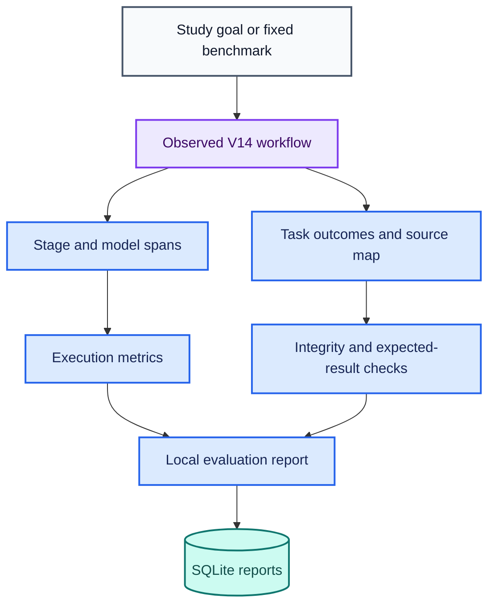

# V15: Evaluation, Tracing, Metrics, and Observability

Status: implemented with actual-corpus benchmark and live Ollama runtime evidence.

## Files and requirements

- `study_guide_v15_evaluation_observability.py`
- `test_v15_evaluation_observability.py`
- This guide, installed as `docs/V15_GUIDE.md`.

Use the existing V13/V14 virtual environment and dependencies. V15 imports V14
as an execution engine and subclasses its nodes to add tracing. V12, V13, and
V14 source files stay unchanged. No hosted tracing service or API key is required.

## Architecture

Diagram colors follow the [architecture color key](ARCHITECTURE.md#diagram-color-key).



## What V15 measures

| Measure | Meaning | Limit |
|---|---|---|
| Elapsed milliseconds | Execution time including graph construction when selected | Excludes source loading, report checks, and report persistence |
| Phase durations | Planning, specialists, evaluation, replanning, and model calls | Nested model time overlaps planning or replanning; do not sum all phases |
| Model attempts and errors | Actual structured model invocations and thrown call errors | A schema-invalid returned object is separately counted as a rejected attempt |
| Accepted model plans | Validated model plan rounds | Does not establish semantic correctness of task decomposition |
| Deterministic plan rounds | Offline planning or model fallback | Offline deterministic planning is expected, not a model failure |
| Model plan acceptance rate | Accepted model plan rounds divided by all planning rounds | Null when no model calls occurred; not a per-attempt percentage |
| Tool attempts and replans | V14's actual execution counters | Failed attempts are included |
| Task completion rate | Completed planned tasks divided by planned tasks | Not learner mastery or complete goal coverage |
| Citation integrity | References exist and researcher source text matches retained evidence | Does not evaluate semantic entailment or external factual truth |
| Case pass rate | Fixed regression cases matching all their expected checks | Five offline cases only; not a broad model-quality score |

Per-task outcomes have trace events, but individual tool latencies are not measured.
The specialists phase has one aggregate latency per execution round. Model token
usage is explicitly unavailable (`null`), rather than estimated from text length.

Traces record ordered sequence numbers, elapsed offsets, span outcomes and errors,
task IDs, agent selections, and execution references. Saved reports include V14
planning events, the original goal, source excerpts, and results; keep them local
unless you explicitly intend to share that content.

## Verification

```powershell
python -m py_compile .\study_guide_v15_evaluation_observability.py .\test_v15_evaluation_observability.py
python .\test_v15_evaluation_observability.py
```

Expected: 27 tests, `OK`, with no skips in the project environment. The two
LangGraph tests skip if LangGraph is absent. Tests need no network or Ollama.
They use scripted model responses and synthetic sources to check deterministic
behavior, actual graph execution, retry/fallback accounting, evidence mismatch
detection, result checking, and database closure on success and failure.

## Local database exclusion

Before the first real run, add this exact line to `.gitignore`:

```text
study_guide_v15_reports.sqlite*
```

The wildcard covers SQLite sidecar files. Reports have unique IDs and are inserted
without replacing an existing record. Reading a saved report uses a read-only
connection and does not invoke models or tools. These are final reports, not
resumable checkpoints. SQLite connections close explicitly on all paths.

## First run: five-case offline benchmark

```powershell
python .\study_guide_v15_evaluation_observability.py --benchmark
```

At `Start evaluation and save a local report? [y/N]:`, enter `y`.

Expected: `V15 benchmark: 5/5 passed` and `Case pass rate: 100%`.

| Case | Expected behavior |
|---|---|
| Arithmetic | `6 * 7 = 42`, calculator selected, one execution |
| Conversion | `5 km = 5000 m`, converter selected, one execution |
| Compound | Approved energy evidence plus arithmetic `60` and conversion `5000 m`, three executions |
| Division by zero | Incomplete, two executions, one replan |
| Missing evidence | Incomplete, two executions, one replan |

The benchmark uses the real repository corpus. The compound case needs the energy
document. The missing-evidence case uses a deliberately unusual query; adding a
document containing that query can change its expected result. If a case fails,
the report lists exactly which expected checks failed.

The two expected failure cases should still PASS the evaluation. A task's failure
status and an evaluation case's failure status describe different things.

Copy the saved report ID. Inspect it without rerunning:

```powershell
python .\study_guide_v15_evaluation_observability.py --show YOUR_REPORT_ID --trace
```

## Second run: observed offline workflow

```powershell
python .\study_guide_v15_evaluation_observability.py --offline
```

Use `Explain conservation of energy; Calculate (12 + 8) * 3; Convert 5 km to m`
as the goal. Confirm with `y`. Expected: three completed tasks, three tool
attempts, no replans, zero model attempts, and passing citation-ID integrity.

## Third run: observed Ollama workflow

```powershell
python .\study_guide_v15_evaluation_observability.py
```

Use the same compound goal and confirm with `y`. This selects `qwen3.5:4b` and
the LangGraph execution engine. Inspect the report ID and saved trace. An accepted
model plan should appear in the metrics; fallback and rejected attempts are
reported separately. Do not claim live model success from the offline benchmark.

Live transport/parser failures handled by V14's retry logic are traced. An unexpected
exception that aborts the entire workflow propagates to the caller; its in-memory
trace is not persisted by this CLI. Interrupted runs cannot be resumed from reports.

## Publication evidence

The actual-corpus offline benchmark passed all five fixed cases. Saved-report
reload returned the same results and durations. Recorded per-case elapsed times
were 0.452 ms for arithmetic, 0.196 ms for conversion, 0.630 ms for compound tool
use, 0.308 ms for division by zero, and 0.711 ms for missing evidence. These are
single-run observations and do not constitute performance guarantees.

The live Ollama and LangGraph run completed all three tasks with three tool
attempts, zero replans, one model attempt, one accepted plan, and zero deterministic
planning rounds. Elapsed time was 234683.861 ms, about 3 minutes 55 seconds.
Arithmetic returned `60 [T2]`; conversion returned `5000 m [T3]`; citation-ID
integrity passed. The researcher returned one Common forms of energy passage.
Semantic entailment was not evaluated, and full conservation-of-energy coverage
was not established by that passage.

All 27 V15 tests passed, including both actual LangGraph tests. The final release CI also passed this suite on Windows and Linux with Python 3.12 and 3.14. Inspect the saved live trace with the command printed by the program; no second live model run is needed for that inspection.

The README and architecture updates reflect the verified runtime evidence. V16 and V17 are now implemented and included in v17.0.0. V15 introduces no additional dependency requirement. See [project status](PROJECT_STATUS.md) for the completed release and verification scope.
