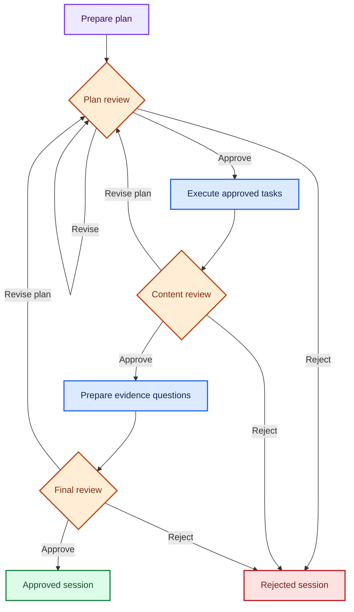

# V16: Multi-stage Human Approval and Interactive Revision

Status: implemented with Windows test, pause/resume, revision, and model-mode runtime evidence.

## Requirements and files

Use the existing project virtual environment and requirements. No new dependency
is introduced. V16 uses LangGraph `interrupt`, `Command(resume=...)`, and the
existing SQLite checkpointer. It reuses V14 plan/tool execution and V15 tracing
and evidence-integrity checks. Earlier source files remain unchanged.

- `study_guide_v16_human_approval.py`
- `test_v16_human_approval.py`
- This guide, installed as `docs/V16_GUIDE.md`.

## Three review gates

Diagram colors follow the [architecture color key](ARCHITECTURE.md#diagram-color-key).



Each gate can pause durably in SQLite. Only an explicit plan approval permits tool
execution. Only approved, complete content with valid evidence references permits
assessment preparation. Final approval marks the session approved. It does not
write generated text or learning outcomes into V11 learner memory.

Model planning can occur before the plan-review gate; tool execution cannot.
Offline mode avoids model calls entirely, while retaining the same LangGraph gates.

## Review commands

| Command | Effect |
|---|---|
| `approve` | Continue from the current gate after deterministic checks |
| `revise` | Edit a task's tool arguments with a reason; return to plan review |
| `reject` | Record a reason and end the session as rejected |
| `pause` | Exit at the saved gate and print the resume command |

Rejection is terminal. Use revision for a correction that should continue through
the workflow. Revision always clears earlier approvals and the generated assessment.
Unchanged successful task results are retained. Changed tasks and their dependents
lose their results and require approval before running again. Up to three revisions
and eight total tool executions are permitted across the whole session.

Invalid JSON, an unknown task or agent, malformed arguments, stale decisions,
and attempts to approve incomplete results cannot bypass a review. The current
gate remains pending with a validation message. There is no automatic replan after
a failed tool call in V16: the reviewer chooses revision or rejection explicitly.

The CLI edits task arguments; it does not offer arbitrary rewriting of source
passages. A research revision can change the query or number of retrieved chunks.
The full validated plan is printed before execution, including all model-generated
arguments. Direct API users can supply a complete replacement plan through the
same validated review decision.

## Tests

```powershell
python -m py_compile .\study_guide_v16_human_approval.py .\test_v16_human_approval.py
python .\test_v16_human_approval.py
```

Expected: 32 tests, `OK`, no skips. Tests need LangGraph and its SQLite checkpointer,
but no network or Ollama. They use synthetic sources, a scripted model, in-memory
checkpoints, and temporary SQLite databases. The suite checks three-gate approval,
rejection at each gate, stale decisions, revisions, dependency invalidation,
budgets, evidence checks, model-call preservation, CLI pause/resume, actual database
reopening, and explicit connection closure.

## Local persistence

Before real runs add this line to `.gitignore`:

```text
study_guide_v16_checkpoints.sqlite*
```

This covers the checkpoint database and sidecar files. Use one local process at a
time for each session. This is a trusted local review workflow, not an authenticated
multi-user approval service. Audit notes record the action, gate, revision, review
ID, reason, and timestamp, but do not establish reviewer identity or tamper-proofing.

Unlike V14/V15 final run reports, these are native LangGraph node checkpoints.
Pauses at review gates can be resumed after exiting the program. The CLI validates
the implementation version, corpus digest, and offline/model mode before resuming.
A changed corpus, version, or mode requires a new session.

Do not promise exactly-once execution after a process crash inside a tool node.
LangGraph can replay interrupted nodes. To avoid silent replay, this CLI refuses
automatic continuation when a session stopped outside a review gate; inspect that
checkpoint separately. Current tools are local retrieval, arithmetic, and unit
conversion, not external mutations. Database connections close explicitly.

## First run: offline pause and restart

```powershell
python .\study_guide_v16_human_approval.py --offline
```

Enter:

```text
Study goal: Calculate 6 * 7; Convert 5 km to m
Open the review workflow? [y/N]: y
plan_review [approve/revise/reject/pause]: pause
```

Copy the printed session ID and resume command. At this point the plan is saved
and zero tools have executed. Resume with the exact command printed, for example:

```powershell
python .\study_guide_v16_human_approval.py --session v16-YOUR_SESSION_ID --offline
```

Confirm opening with `y`. At `plan_review` enter `approve`. Verify arithmetic 42
and conversion 5000 m, then enter `pause` at `content_review`. Resume the same
command again, approve content, review the evidence questions, and approve the
final gate. Expected: stage/status `approved` and two total tool executions.
The resume command uses the actual ID printed by your run; do not copy the
placeholder ID literally.

## Revision example

Start a separate offline session with `Calculate 1 / 0`. Approve the plan; the
content review should show a failed calculation. Enter:

```text
content_review [approve/revise/reject/pause]: revise
Reason: Correct the zero denominator
Task to edit (for example task1): task1
Replacement arguments as JSON: {"expression":"1 / 2"}
```

The revised plan pauses for approval. Approve it; the result should be 0.5.
Approve content and final review. Expected: revision 1, two tool executions in
total, and an approved session. The failed attempt remains in the audit/trace.

For a research task, an argument edit can look like:

```json
{"query":"conservation total energy closed system", "top_k":4}
```

## Model mode

Run without `--offline` for a new session to use `qwen3.5:4b` in the initial
planner. Review the plan before approving tool execution. A matching paused
session reloads without repeating the planner. Retain `--offline` when resuming
an offline session; omit it for a model session.

## Assessment and trace limits

Version `v16.2` labels the current approved task from its tool arguments, including
after human edits. It displays the original task request separately as history.
Evidence questions refer to the approved task, so a revised `1 / 2` calculation
does not keep a question about the original `1 / 0`. The inherited V14 status
heading is omitted from V16's display. Sessions created with `v16.1` remain stored
but cannot resume under `v16.2`; start a fresh session after installing the update.

The assessment consists of deterministic evidence-review questions, one per
planned task, using only references in the approved results. Questions are not
automatically graded, and the workflow does not infer mastery. Human approval
does not turn incomplete retrieval coverage into a factual-quality guarantee.
Inherited citation checks validate IDs and retained text, not semantic entailment.

V15 trace events are retained with unique session-wide sequence numbers and segment
IDs. Duration and offset measurements are relative to each node segment, not total
wall time across pauses. Human waiting time is not measured. The program currently
stores the review trace in V16 checkpoints rather than exporting a V15 report.

## Official mechanism reference

LangGraph's interrupt documentation describes pause/resume and the node-restart
behavior. V16 keeps model/tool work in separate nodes from interrupts so resuming a
review only repeats pure payload construction:

https://docs.langchain.com/oss/python/langgraph/interrupts

## Verified evidence

- All 32 tests passed on Windows in about 0.906 seconds.
- An offline two-task session paused after content generation, exited the process,
  resumed at content review, and completed all approvals with exactly two executions.
- An offline failed `1 / 0` task was revised to `1 / 2` with a reason. Earlier
  approvals were cleared, the revised plan required fresh approval, and the session
  completed at revision 1 with two executions and the result `0.5 [T2]`.
- That revision check exposed a stale label and question referring to the original
  `1 / 0`. Version `v16.2` fixes both with current-argument labels, retains the
  original wording separately, and adds regression coverage.
- A live model-mode `v16.2` conversion session completed with `5000 m [T1]`, one
  execution, all three approval gates, and a question describing the approved task.
- A successful model-mode session alone does not distinguish model planning from
  deterministic fallback. Inspect the saved checkpoint's `events` to establish
  the actual planning path; tests cover model-call preservation across resume.

The main README and architecture guide reflect these observations. V17 is now implemented and published as part of v17.0.0, with the browser/API layer, Docker persistence checks, and CI. See [project status](PROJECT_STATUS.md).
