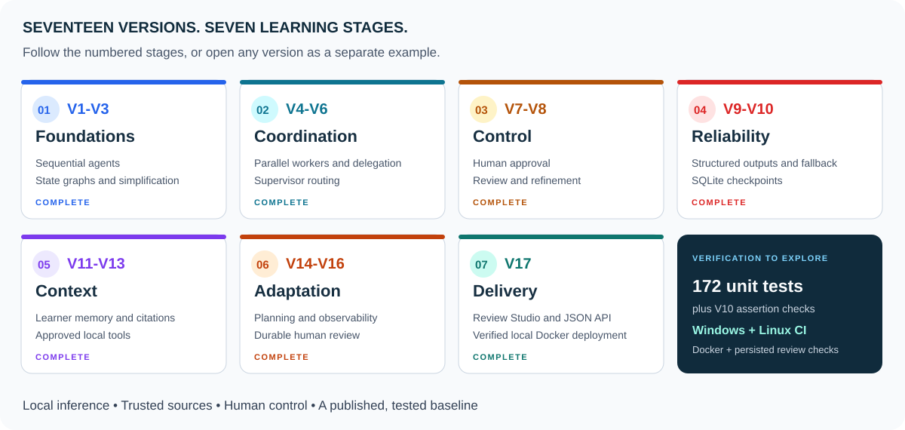

# 🎨 Visual guide to the study project

Use the same three reading paths as the Local AI Agent project: learn the concepts, explore their implementation, and inspect the evidence. This project spans 17 versions, so the visual map groups them into seven learning stages.

## 🧭 Pick a reading path

| Your goal | Start here | Continue with |
| --- | --- | --- |
| Understand the progression | [README roadmap](../README.md#version-roadmap) | [Architecture diagrams](ARCHITECTURE.md) |
| Run the finished application | [V17 start guide](../V17_START_HERE.md) | [API, persistence, and Docker](V17_GUIDE.md) |
| Compare an agent pattern | Open its version in the roadmap | Follow the linked Python file and matching diagram |
| Review reliability evidence | [Final source and diagram audit](FINAL_AUDIT.md) | [CI checks](CI_GUIDE.md), [project status](PROJECT_STATUS.md), and [release](https://github.com/anne500/multi-agent-study-guide/releases/tag/v17.0.0) |

## 🟪 Read the diagram colors

The [architecture color key](ARCHITECTURE.md#diagram-color-key) assigns a role to each node color:

- **Purple:** model-capable planning and generation.
- **Blue:** application logic, deterministic tools, validation, and reporting.
- **Amber:** a control decision, such as schema validity or remaining budget.
- **Orange:** a human review gate.
- **Teal:** persistent storage or trusted source documents.
- **Green:** a completed or approved outcome.
- **Red:** a blocked, rejected, or incomplete path.

Read the node labels and arrow conditions alongside the colors. Offline planning and deterministic fallback remain available in the versions that implement them. A purple node does not mean a model is invoked during every run.

The numbered learning-map cards use colors to group stages. Those stage colors are distinct from the component-role colors inside a workflow diagram. Each card includes its version range and stage name, so color is never the only cue.

## 🖼️ Visual assets and navigation

| Element | Source | Purpose |
| --- | --- | --- |
| Project banner | [project-banner.svg](assets/project-banner.svg) | Introduces the V1-V17 scope, local stack, release, and completion milestone |
| Learning map | [learning-journey.svg](assets/learning-journey.svg) | Groups the 17 separate versions into seven numbered stages |
| README approval overview | [README architecture](../README.md#workflow-architecture) | Shows the durable review flow used by V17 |
| Per-version workflows | [ARCHITECTURE.md](ARCHITECTURE.md) | Preserves the detailed flows for every version |

The SVG assets contain text and shapes, scale with the page, and include accessible titles and descriptions. They use system fonts and require no JavaScript. The README uses descriptive image text, labeled badges, and stable custom anchors. Long source-file and verification tables remain available in expandable sections.

## ✅ Scope and evidence

This presentation update was prepared on November 8, 2026, using the Local AI Agent repository's badges, emoji headings, architecture overview, and Learn / Explore / Evidence organization as a reference. The study-guide implementation milestone remains November 3, 2026, and its published code baseline remains v17.0.0.

The original final audit records 23 Mermaid diagrams at its audited checkpoint. This refresh colors those 23 diagrams and adds one README approval overview, for 24 diagrams across the current documentation. Node labels, arrows, routing, and version order in the original diagrams are preserved. Verification for the refresh covers diagram parsing/rendering, source comparisons, asset bounds, Markdown links, anchors, and local page previews.

The project remains complete for the documented local, single-user learning scope. The presentation does not add model-quality results, a public deployment, or an integration with another project. Use the linked evidence pages to assess those boundaries.

## 🔎 Presentation verification

| Check | Result |
| --- | --- |
| Existing diagram structure | All 23 original diagrams retain their node labels and arrows; only style declarations were added |
| Current Mermaid rendering | All 24 diagrams parsed and rendered with Mermaid 12.3.0 in Chromium 153.0.8010.0; no detected clipped text |
| Static SVG assets | Both assets parsed as XML and rendered within their 1200-pixel view boxes; no clipped text |
| README navigation | Stable custom anchors and jump links resolved in the local preview |
| Responsive layout | The 390-pixel preview had no page-level horizontal overflow; wide tables scroll within the page |
| Setup and evidence blocks | Existing README fenced command and evidence blocks were preserved |
| Version order | V1-V17 remains ordered and complete in the roadmap |

The page preview approximates GitHub Markdown styling. GitHub's own fonts, emoji support, badge service responses, Mermaid version, and theme can differ. The SVG artwork is static; the diagrams and navigation remain readable through their text labels and documentation links.
